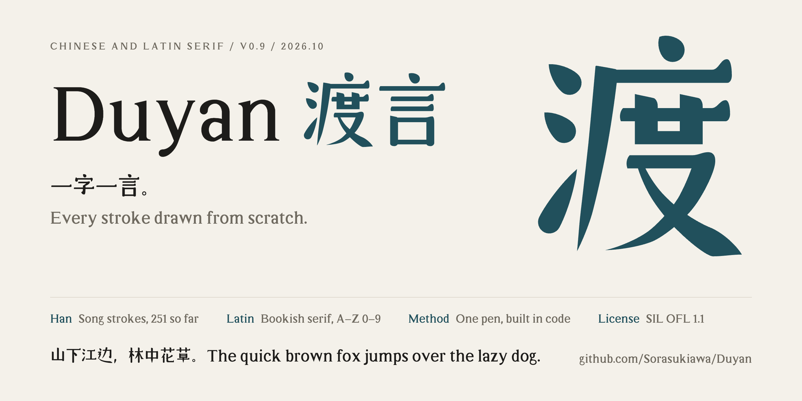

<p align="center"></p>

# 渡言 Duyan

**简体中文** · [English](README.en.md)

**一字一言。** 一款从零自绘的中英文衬线字体，正在造字中。

西文是温和、有书卷气的衬线，汉字用同一支笔来写：竖粗横细，点是圆圆的水滴，横画末端带一个圆润的喙。汉字还在一个字一个字地补齐、打磨。名字里的「渡」，是在中文和英文之间摆渡。所有字形都从零画出，没有使用任何现成字体的轮廓。

[设计与造字方式](docs/DESIGN.md) · [汉字结构规范](docs/STRUCTURE.md)

## 进度

现在是 0.9 小样，还不能当正文字体用：没收录的字会由系统里的其他字体顶上。

- 西文：大小写字母、数字、常用标点，226 个常用字距对。还没有 &、@、# 这类符号和带重音的字母。
- 汉字：251 个常用字（简体），另有假名「の」和中文逗号、句号。
- 只有 Regular 一个字重。

接下来按部件继续扩字，大致的节点：

| 阶段 | 汉字数 | 大约能覆盖的日常文字 |
| --- | --- | --- |
| 现在 | 251 | |
| 下一步 | 500 | 八成 |
| | 1000 | 九成 |
| | 2500（常用字） | 98% |
| | 3500 | 99.5% |
| 完整 | 6763（GB 2312） | |

之后再补繁体中文、日文写法不同的字和更多字重。

## 试用

- 字体文件：[`sample/Duyan-Sample.otf`](sample/Duyan-Sample.otf)（OpenType CFF），装好后在字体菜单里叫「渡言 小样」（英文系统里叫 Duyan Sample）。
- 小样页：在仓库目录里起一个本地服务，再打开 http://localhost:8766/sample/

```bash
python3 -m http.server 8766
```

## 标志和封面

[`brand/`](brand/) 里是文字标（`logo.svg`，深色背景用 `logo-dark.svg`）、单字图标（`mark.svg`、`icon.svg`）和封面（`cover.png`）。文字标是两色的「Duyan 渡言」：西文墨色，汉字黛青；单字图标是黛青的「渡」。字都直接取渡言自己的字形轮廓，由 `python3 tools/brand.py` 生成。

## 自己构建

需要 Python 3.9 以上。

```bash
pip3 install -r requirements.txt
```

```bash
python3 build.py
```

`build.py` 先按设计意图检查每个字（该藏起来的端点有没有露头、轮廓有没有打结、两笔之间有没有窄缝、汉字的结构和间距……），再生成 `sample/Duyan-Sample.otf`；在 macOS 上还会核对系统渲染。检查规则和造字方式见 [docs/DESIGN.md](docs/DESIGN.md) 和 [docs/STRUCTURE.md](docs/STRUCTURE.md)。

## 反馈

还在早期。觉得哪个字别扭，欢迎在 Issues 里说，最好附上截图和字号。

## 授权

渡言采用 [SIL Open Font License 1.1](OFL.txt)：可以免费使用（包括商用）、嵌入网页和文档、修改和再分发；改出来的字体也要继续用 OFL，并且不能把字体文件单独拿去卖。造字代码和构建脚本属于字体的源文件，同样按 OFL 授权。
